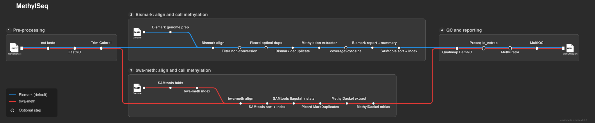

---
hide:
  - navigation
  - toc
---

<div class="ms-hero" markdown>

:material-dna:{ .ms-hero\_\_icon }

# MethylSeq

<p class="ms-hero__tagline">Methylation sequencing analysis, from FastQ files to methylation calls and QC reports, using Bismark or bwa-meth + MethylDackel.</p>

[Get started](#quick-start){ .md-button .md-button--primary }
[Usage](usage.md){ .md-button }

[](https://www.nextflow.io/)
[](https://github.com/nf-core/tools/releases/tag/4.1.0)
[](https://docs.conda.io/en/latest/)
[](https://www.docker.com/)
[](https://sylabs.io/docs/)
[](https://github.com/askimed/nf-test)

</div>

MethylSeq is the TOBI lab version of the [nf-core/methylseq](https://nf-co.re/methylseq/2.6.0) pipeline (version 2.6.0). It trims and aligns bisulfite sequencing reads, extracts the methylation calls and summarises the quality control of all samples in a MultiQC report. It can also remove optical duplicates, filter reads with an incomplete bisulfite conversion and estimate the CpG-level sequencing saturation with [methurator](https://vibtobilab.github.io/methurator/latest/).

<div class="grid cards ms-cards" markdown>

- :material-rocket-launch:{ .lg .middle } **Quick start**

  ***

  Prepare the samplesheet, pick the aligner and run the pipeline with Docker or Singularity.

  [:octicons-arrow-right-24: Quick start](#quick-start)

- :material-file-document-edit-outline:{ .lg .middle } **Usage**

  ***

  Samplesheet, aligners, library types and the optional steps of the pipeline.

  [:octicons-arrow-right-24: Usage](usage.md)

- :material-tune-variant:{ .lg .middle } **Parameters**

  ***

  Every parameter of the pipeline, generated from its parameter schema.

  [:octicons-arrow-right-24: Parameters](parameters.md)

- :material-folder-table-outline:{ .lg .middle } **Output**

  ***

  Alignments, methylation calls, QC reports and the MultiQC report.

  [:octicons-arrow-right-24: Output](output.md)

</div>

## Pipeline overview

[](images/methylseq_metro.html)

_Click the map to open the interactive version, which you can pan, zoom and filter by line._

The pipeline runs one of two workflows, chosen with `--aligner`: [Bismark](https://github.com/FelixKrueger/Bismark) (`bismark`, the default, with Bowtie2, or `bismark_hisat` with HISAT2) or [bwa-meth](https://github.com/brentp/bwa-meth) with [MethylDackel](https://github.com/dpryan79/methyldackel) (`bwameth`).

| Step                                                    | Bismark workflow      | bwa-meth workflow     |
| ------------------------------------------------------- | --------------------- | --------------------- |
| Generate the reference genome index _(optional)_        | Bismark               | bwa-meth              |
| Merge re-sequenced FastQ files                          | cat                   | cat                   |
| Raw data QC                                             | FastQC                | FastQC                |
| Adapter trimming                                        | Trim Galore!          | Trim Galore!          |
| Align reads                                             | Bismark               | bwa-meth              |
| Filter reads with an incomplete conversion _(optional)_ | Bismark               | -                     |
| Remove optical duplicates                               | Picard MarkDuplicates | -                     |
| Deduplicate alignments                                  | Bismark               | Picard MarkDuplicates |
| Extract methylation calls                               | Bismark               | MethylDackel          |
| Sample and summary reports                              | Bismark               | -                     |
| Alignment QC                                            | Qualimap              | Qualimap              |
| Library complexity _(optional)_                         | Preseq                | Preseq                |
| CpG-level sequencing saturation _(optional)_            | methurator            | methurator            |
| Project report                                          | MultiQC               | MultiQC               |

## Quick start

!!! tip "New to Nextflow?"

    See [this page](https://nf-co.re/docs/usage/getting_started/installation) on how to set up Nextflow (>= 26.04.0) and Docker or Singularity. Test your setup with `-profile test,docker` before running the pipeline on your own data.

1.  Prepare a [samplesheet](usage.md#samplesheet) with one row per FastQ file (single-end) or pair of FastQ files (paired-end):

    ```csv title="samplesheet.csv"
    sample,fastq_1,fastq_2
    SAMPLE1_S1,SAMPLE1_S1_R1.fastq.gz,SAMPLE1_S1_R2.fastq.gz
    SAMPLE2_S2,SAMPLE2_S2_R1.fastq.gz,
    ```

2.  Write the parameters in `params.yaml`, with a reference genome given by its iGenomes name (`genome`) or as a FASTA file (`fasta`):

    ```yaml title="params.yaml"
    input: ./samplesheet.csv
    outdir: ./results
    fasta: ./reference/genome.fa
    aligner: bismark
    rrbs: true
    ```

3.  Run the pipeline:

    === "Docker"

        ```bash
        nextflow run VIBTOBIlab/MethylSeq -params-file params.yaml -profile docker
        ```

    === "Singularity"

        ```bash
        nextflow run VIBTOBIlab/MethylSeq -params-file params.yaml -profile singularity
        ```

The results are described on the [output](output.md) page.

## Credits

The original nf-core/methylseq pipeline was written by Phil Ewels ([@ewels](https://github.com/ewels/)) for use at the [National Genomics Infrastructure](https://portal.scilifelab.se/genomics/) at [SciLifeLab](http://www.scilifelab.se/) in Stockholm, Sweden, and is maintained by Felix Krueger ([@FelixKrueger](https://github.com/FelixKrueger)), Sateesh Peri ([@sateeshperi](https://github.com/sateeshperi)) and Edmund Miller ([@emiller88](https://github.com/emiller88)), with contributions from Rickard Hammarén ([@Hammarn](https://github.com/Hammarn/)), Alexander Peltzer ([@apeltzer](https://github.com/apeltzer/)) and Patrick Hüther ([@phue](https://github.com/phue/)).

This version was modified by Edoardo Giuili ([@edogiuili](https://github.com/edogiuili)), who maintains it together with Sofie Van de Velde ([@sofvdvel](https://github.com/sofvdvel)).

## Citation

If you use this pipeline for your analysis, please cite the nf-core publication:

!!! quote ""

    **The nf-core framework for community-curated bioinformatics pipelines.**

    Philip Ewels, Alexander Peltzer, Sven Fillinger, Harshil Patel, Johannes Alneberg, Andreas Wilm, Maxime Ulysse Garcia, Paolo Di Tommaso & Sven Nahnsen.

    _Nat Biotechnol._ 2020 Feb 13. doi: [10.1038/s41587-020-0439-x](https://dx.doi.org/10.1038/s41587-020-0439-x)

The tools used by the pipeline are listed on the [citations](citations.md) page.
